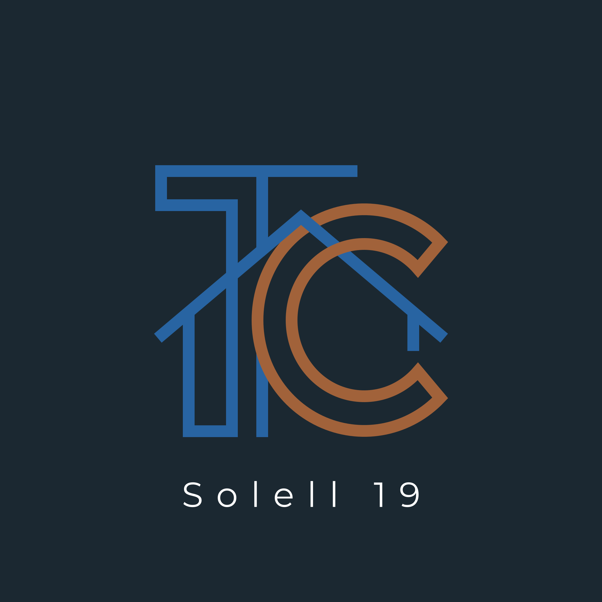

# Solell

Les factures de casa (Solell 19) en una pàgina: llum, aigua i telèfon, què es
paga cada mes i com canvia d'un any a l'altre.

**https://roninsilent.github.io/solell/**

## Les pàgines

| | |
|---|---|
| `index.html` | el menú: troba sol les pàgines noves del repositori |
| `mati.html` | el resum de cada matí |
| `factures.html` | les factures de casa |

Cada app és un sol fitxer, sense cap pas de compilació. El menú no demana
entrar-hi; les altres dues sí.

## Com funciona

Les dades no es toquen des d'aquí. Cada dilluns al matí una tasca automàtica
mira els correus de les companyies, desa els PDF al Drive de casa i hi deixa
un fitxer `solell-factures.json`. L'app només el llegeix.

- Entra-hi amb **roninsilent@gmail.com**; qualsevol altre compte el rebutja.
- El menú mira quins `.html` hi ha al repositori i en llegeix el títol i la
  descripció: una pàgina nova hi surt sola, sense tocar el menú.
- El permís que demana és `drive.file`: només veu els fitxers que ha creat
  ella mateixa. Per això, la primera vegada que s'hi entra crea el
  `solell-factures.json` buit, i a partir d'aquell moment la tasca setmanal ja
  el pot omplir.
- Els PDF viuen a `Compartit Anna/Solell 19/Factures`, una subcarpeta per tipus.

## Pestanyes

| | |
|---|---|
| Resum | què ha costat la casa els últims 12 mesos i què hi falta |
| Llum | kWh comprats i abocats a la xarxa, i l'import de cada mes |
| Aigua | consum i import de cada trimestre |
| Telèfon | l'import de cada mes |
| Altres despeses | assegurances, manteniments i impostos: què costen, quan es cobren i a qui trucar |
| Totes | la llista sencera, amb cercador i enllaç al PDF |

## Altres despeses

Les assegurances, el manteniment de l'aerotermia i els impostos de la casa són
a la clau `despeses` del mateix JSON. La tasca setmanal no les toca: s'omplen a
mà, a `zenkai3d-factures.json` (el fitxer mestre), i el dilluns passen soles a
`solell-factures.json`. Cada una porta el cost i la periodicitat, la data de
cobrament (l'app calcula la propera), els telèfons de qui cal trucar, que a
l'iPhone es truquen tocant-los, i d'on surten les dades. Les que no tenen
import surten marcades i no compten a la suma.

## Resum del matí

`mati.html` ensenya el resum que es genera cada matí a les 6:54: el temps dels
tres llocs, l'agenda, qui treballa i els missatges que demanen resposta. Llegeix
`solell-resum-mati.json` del mateix Drive i en guarda els últims catorze dies.

El resum el redacta en Gemini i arriba com una pàgina sencera d'HTML. L'app no
l'enganxa tal qual: n'extreu el bloc `.shell`, el torna a muntar etiqueta per
etiqueta amb una llista del que hi pot haver i descarta la resta, de manera que
ni un `<script>` ni un `onclick` ni un enllaç que no sigui `https:` o `mailto:`
hi poden entrar.

## El vestit

El logo és la T i la C entrellaçades dins la silueta de la casa: la T i la
teulada en blau (#2864A2), la C en coure (#A1623A), sobre un blau nit
(#1B2831). La teulada passa per sobre de l'arc de fora de la C i per sota del de
dins. `logo.svg` és el logo sencer, redibuixat en vector; dins de cada pàgina
hi ha només la marca, i `icona.png` és la que surt a la pantalla d'inici de
l'iPhone. A la pestanya del navegador la marca va amb el traç més gruixut,
perquè a 16 píxels el fi es perdia.

Les tres pàgines fan servir el mateix fons blau nit i la Montserrat del logo:
la regular amb les lletres espaiades per al nom de la casa, i la seminegreta
per als titulars i les xifres. La resta del text és la lletra del sistema. La
Montserrat és al repositori, retallada als caràcters llatins, de manera que cap
pàgina no depèn de Google Fonts ni de cap altre lloc.

El coure i el blau del logo són foscos per anar com a text sobre el blau nit,
així que cada un té una versió més clara per a enllaços, icones i accents
(#D49166 i #78A9E0). El coure tal qual omple els botons, amb el text en blanc.

Els detalls visuals vénen del mediakit de Zenkai3D (`dossier.html`), canviant el
taronja i el blau d'allà pel coure i el blau d'aquí. El titular és gran i
atapeït, amb el tros que importa en coure. Els títols de secció són petits, en
majúscules, i una ratlla els allarga fins al marge. Les xifres grans van en
coure, i les de l'aigua en blau. Les targetes tenen les cantonades rectes i una
vora de color a l'esquerra: blava a les dels gràfics, de coure a les despeses i
als missatges del matí, i alternada a les apps del menú. La xifra gran del resum
de factures i les targetes del dia la duen a dalt, de coure. Les píndoles (Menú, xips i pestanyes al mòbil) es queden rodones. Del mediakit no
s'ha agafat la lletra ni el mode clar, perquè Solell ja té els seus.

Als gràfics de les factures, la llum és el coure i l'aigua el blau; el telèfon
va a un gerd i els excedents a un verd. Les quatre sèries s'han passat per un
simulador de daltonisme sobre el fons de les targetes; la llum i els excedents
són els que s'assemblen més, i per això uns van cap amunt i els altres cap avall.
